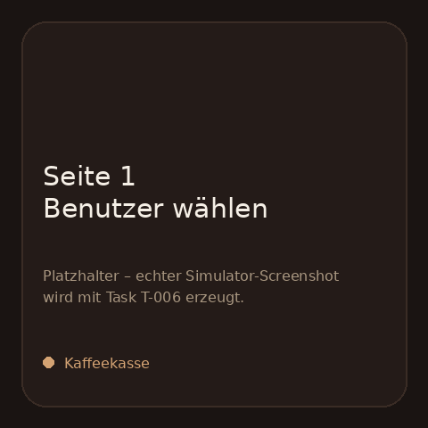
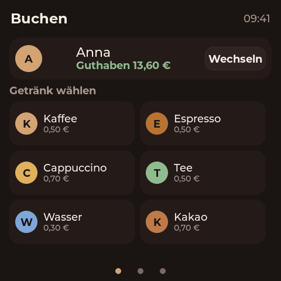
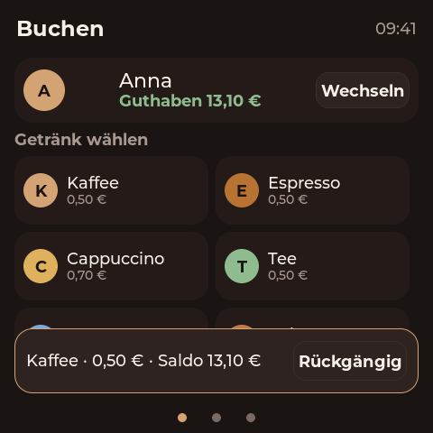
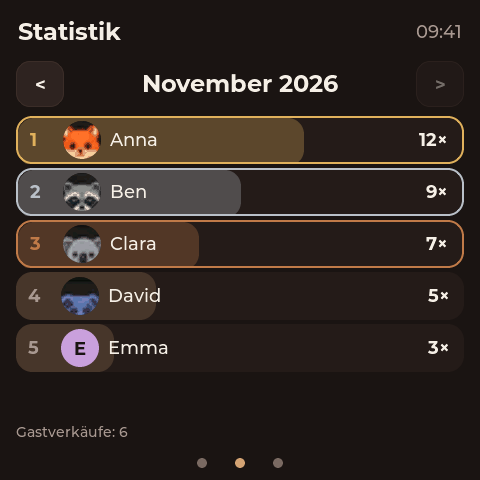
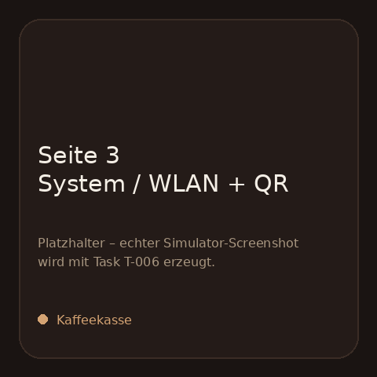
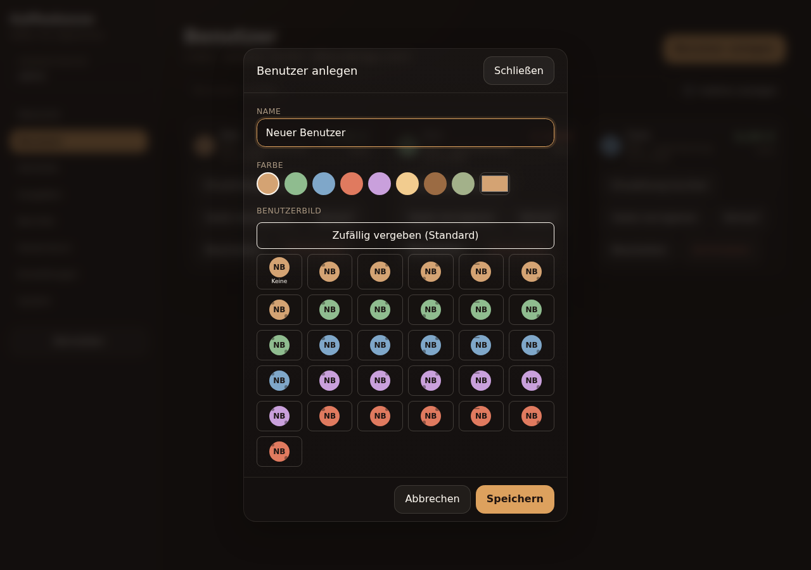

# Kaffeekasse

A self-contained coffee fund kiosk for the **Guition ESP32-4848S040** (ESP32-S3,
4.0" 480×480, ST7701S RGB panel, GT911 touch, 16 MB flash, 8 MB PSRAM).

- **Device:** trust-based, two-tap booking on LVGL 9. Select your name, tap a
  drink, done. Optional guest cash sales.
- **Admin:** on-device web backend over a demand-activated WLAN AP (or the LAN).
  Users, drinks, payments, expenses, reports, CSV exports, backup, OTA, display
  settings.
- **Self-contained:** no cloud, no external database, no runtime internet
  dependency. Optional STA Wi-Fi is only used for time sync and convenience.

## Status

Early development. See `docs/` for architecture, task board and decisions.

## Screenshots

Generated by the LVGL SDL simulator with seeded demo data (`make screenshots`).
The device UI is 480×480, German, espresso-themed.

| Buchen | Benutzer gewählt | Buchung + Rückgängig |
|---|---|---|
|  |  |  |

| Statistik | System / WLAN-QR |
|---|---|
|  |  |

## Optional user avatars (feature branch)

The `feature/user-avatars` branch adds **30 built-in, static avatar presets**
to help identify coffee members. A member's initials remain legible on each
avatar, and preset `0` retains the original coloured-initials display.
The presets are drawn with small LVGL shapes rather than uploaded images.

The administrator assigns an avatar under **Benutzer → Bearbeiten → Benutzerbild**.
Only the authenticated admin web interface can change it. The selection is
saved with the user, included in regular backups, and survives a restart.

| Admin: 30 avatar choices (preview) |
|---|
|  |
Existing users require no migration.

**Preview:** The booking and selected-user screenshots above are generated from
the simulator with preset avatars for Anna, Ben, Clara and David, while Emma
demonstrates the initials-only fallback. The admin's user list is shown under
[admin screenshots](docs/ui/screenshots/README.md#admin-web).
See [UI specification](docs/ui.md) and
[ADR 0014](docs/adr/0014-user-avatar-presets.md) for technical details.

> Screenshot images must be regenerated and committed alongside any visible UI
> change. After editing the LVGL view, run `make screenshots` and
> `make screenshots-check`; for admin changes run
> `npm --prefix web run screenshots`. This repository's `main` branch keeps
> the original images until the feature is merged.

## Quick start

```sh
make bootstrap    # check toolchains, install web dependencies
make test         # host unit tests + web unit tests
make web          # build the admin SPA
make assets       # embed the SPA into the firmware
make build        # build firmware (requires ESP-IDF 5.x or Docker)
make flash        # flash /dev/ttyUSB0
make hil          # hardware smoke test (skips without a board)
make sim          # LVGL simulator on the host (interactive)
make screenshots  # regenerate the committed device screenshots
make test-ui      # LVGL click/hit-test smoke test
make check        # everything CI runs
```

The board is normally at `/dev/ttyUSB0` (CH340). Flashing from Docker:

```sh
make build-docker
make flash
```

## Documentation

| Document | Contents |
|---|---|
| `AGENTS.md` | Rules and workflow for human and AI contributors |
| `docs/architecture.md` | Runtime architecture and module boundaries |
| `docs/hardware.md` | Board, pin map, display/touch/power notes |
| `docs/data-model.md` | Domain types and ledger schema |
| `docs/accounting.md` | Post-pay, guest cash sales, cash reconciliation |
| `docs/api/openapi.yaml` | Admin REST contract |
| `docs/api/reports.md` | Expected report JSON payload shape and CSV conventions |
| `docs/ui.md` | Device and admin UI specification |
| `docs/security.md` | Threat model, auth, AP policy |
| `docs/operations.md` | Provisioning, backup, OTA, recovery |
| `docs/serial-cli.md` | Serial protocol, clock/backup/reset commands |
| `docs/testing.md` | Test strategy and hardware-in-the-loop |
| `docs/tasks/` | Task board for parallel agents |

## License

MIT. See `LICENSE`.
