# Screenshots

Device screenshots are generated by the LVGL simulator (`make screenshots`) and
committed so reviewers can see the device UI without hardware. Screenshot mode
fixes `TZ=Europe/Berlin`, the C locale, the wall clock and the LVGL tick, so
results are independent of the host timezone. CI regenerates the set and
compares decompressed pixels (`make screenshots-check`). The example users
include four avatar presets and one initials-only fallback; the web user list
also uses predefined avatars in its mock data.

| Page 1 — booking | Page 1 — selected |
|---|---|
| 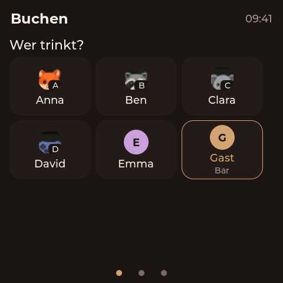 | 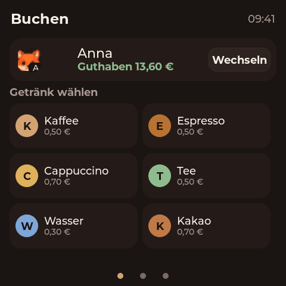 |

| Booking toast | Page 2 — leaderboard |
|---|---|
| 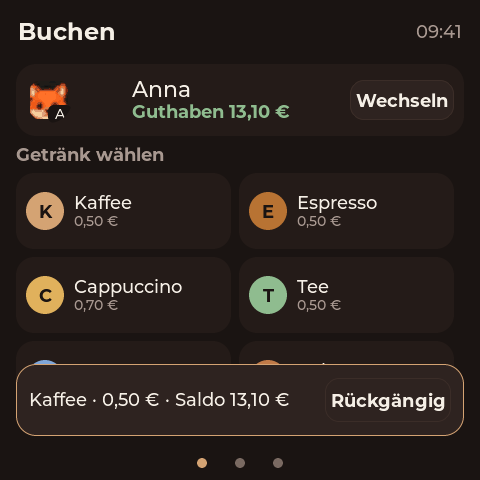 | 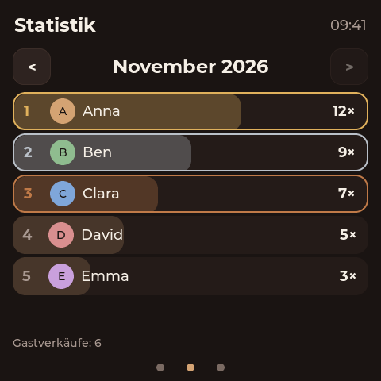 |

| Page 3 — system / AP QR |
|---|
| 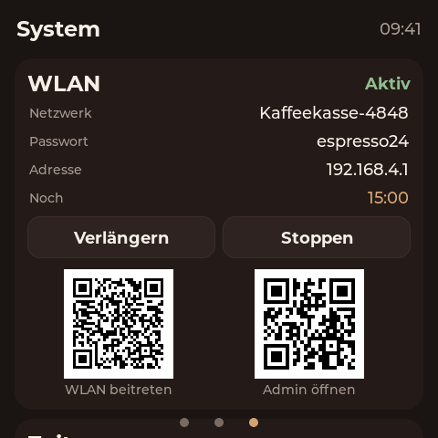 |

## Admin web

Generated by `npm --prefix web run screenshots` against the mock API
(`web/mock/server.mjs`). Desktop 1280×900, mobile 390×844.

| Login | Übersicht |
|---|---|
| 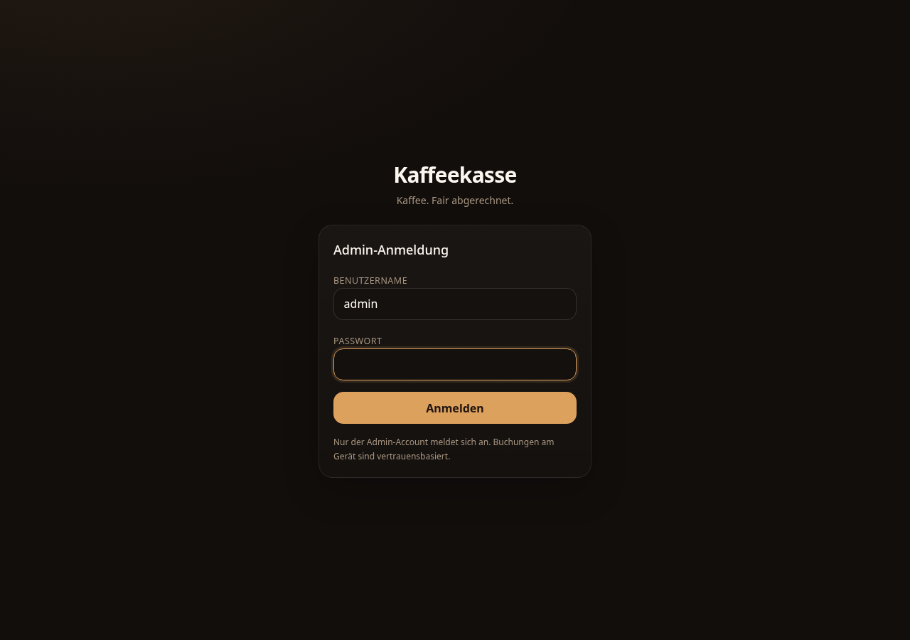 | 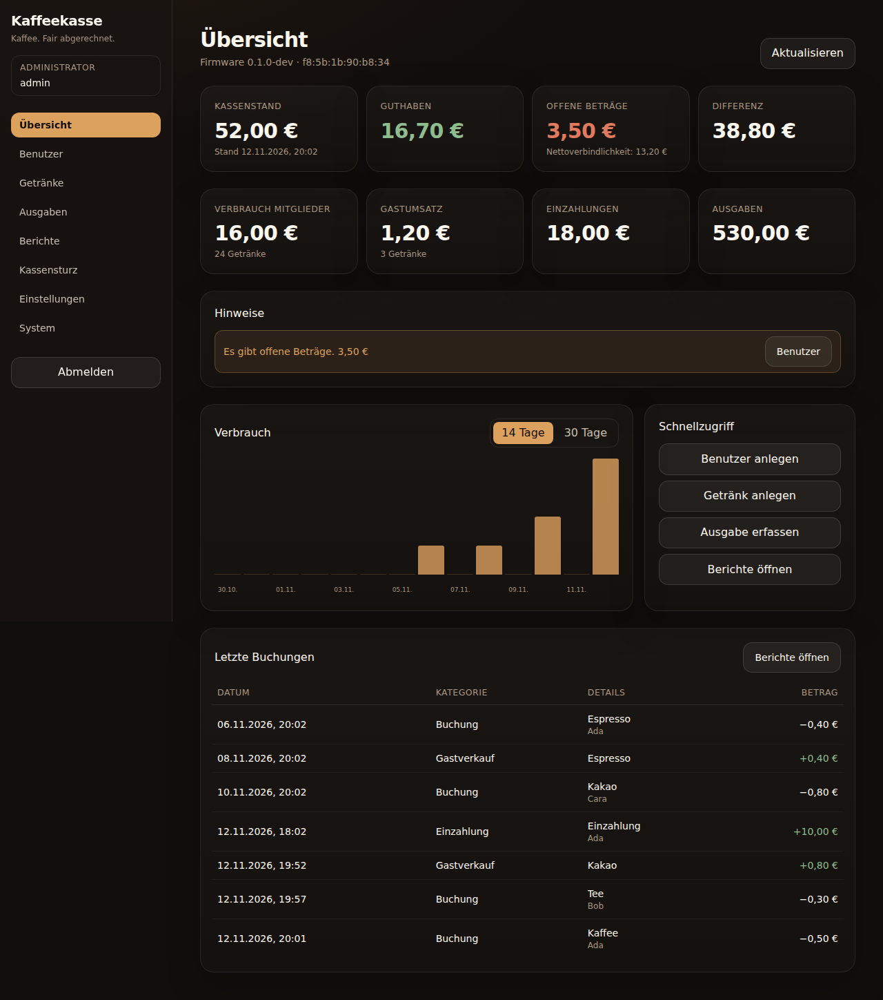 |

| Benutzer | Neuanlage (Zufalls-Avatar) |
|---|---|
| 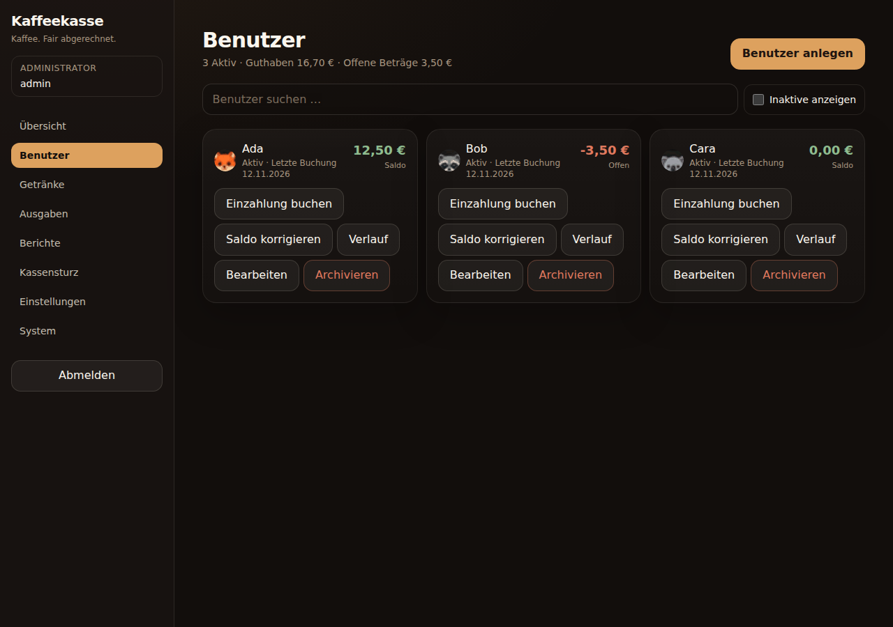 | 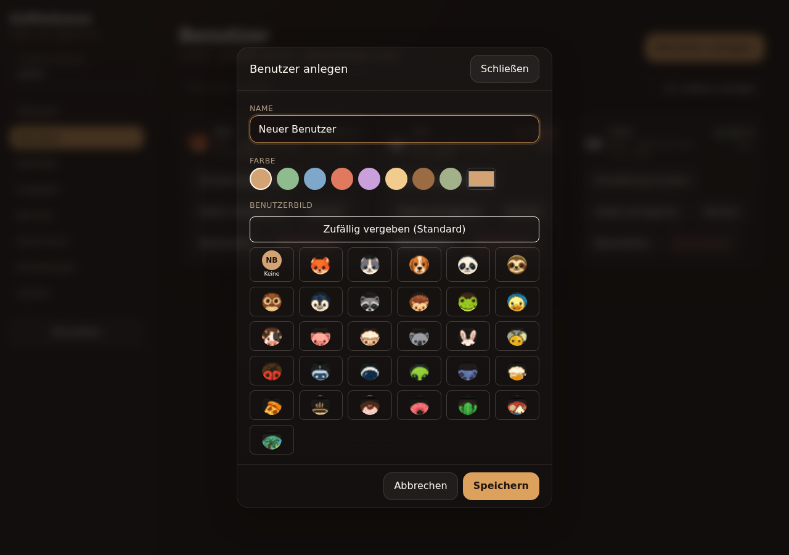 |

| Neuer Benutzer mit automatisch vergebenem Avatar |
|---|
| 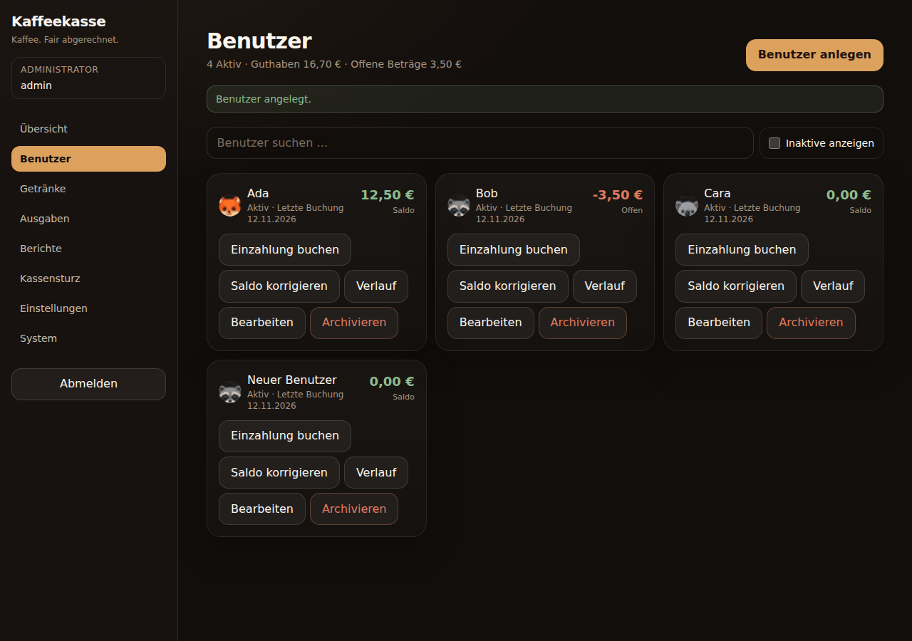 |

| Getränke |
|---|
| 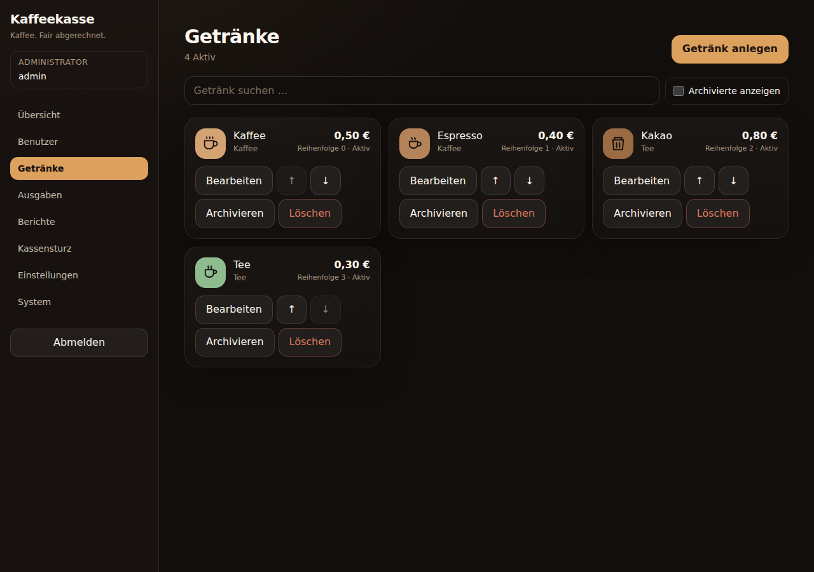 |

| Ausgaben | Kassensturz |
|---|---|
| 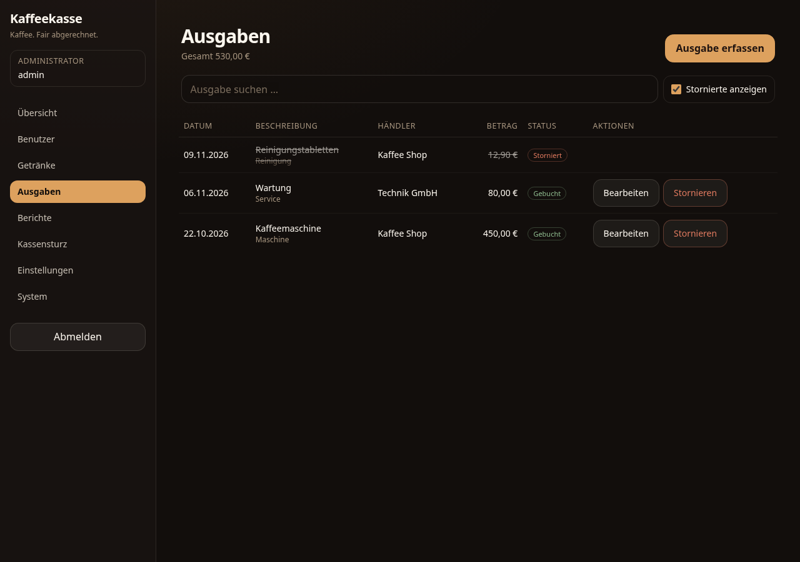 | 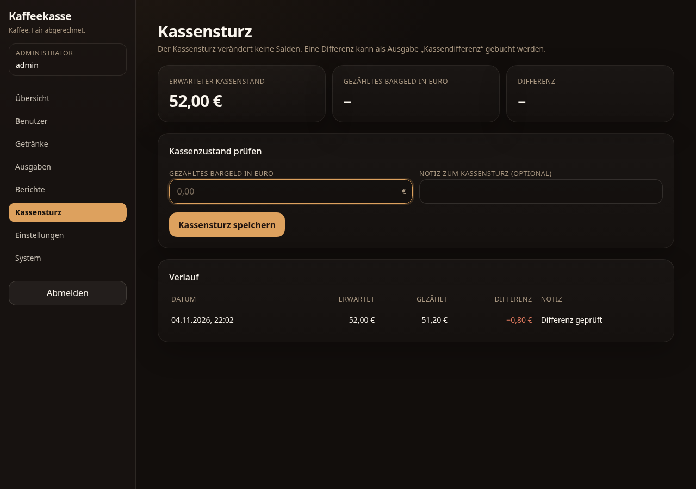 |

| Berichte | Einstellungen |
|---|---|
| 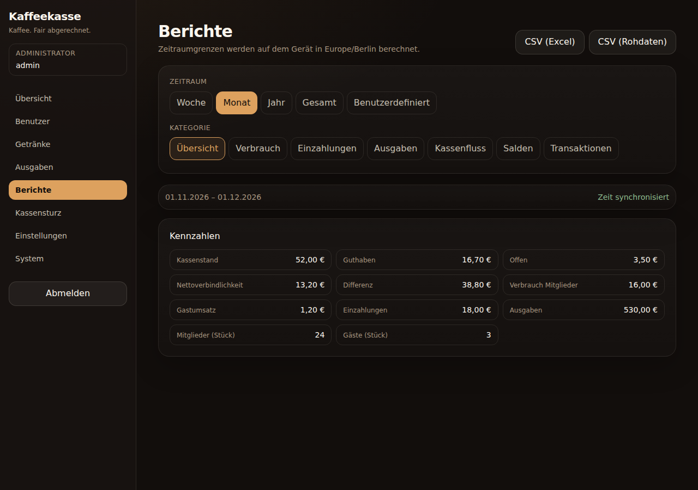 | 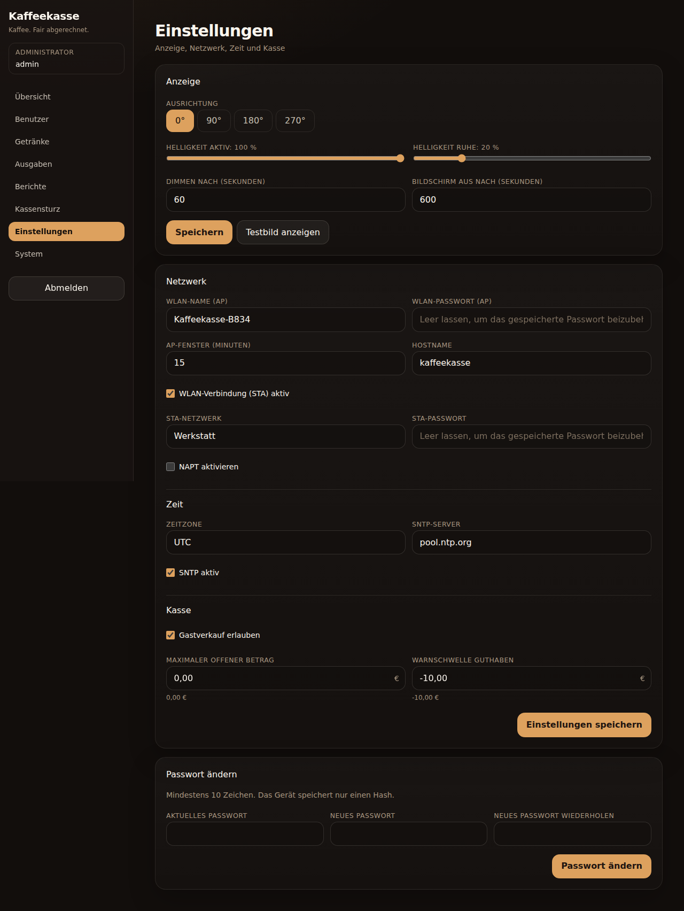 |

| System / AP QR |
|---|
| 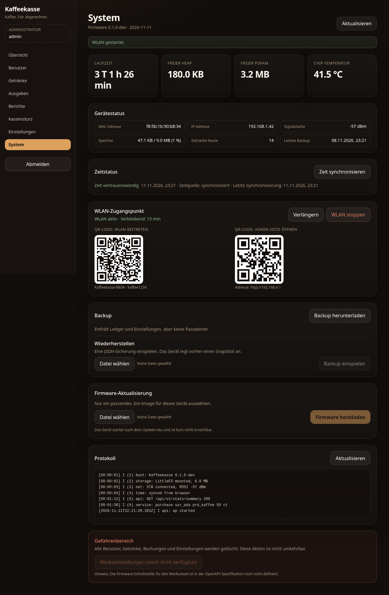 |

| Mobile Übersicht | Mobile Benutzer |
|---|---|
| 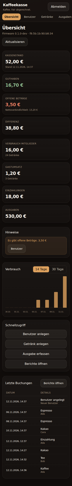 | 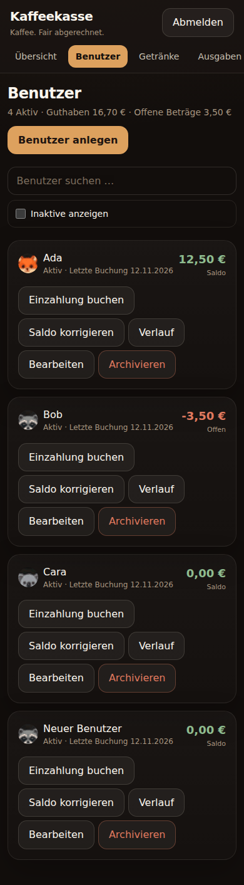 |
